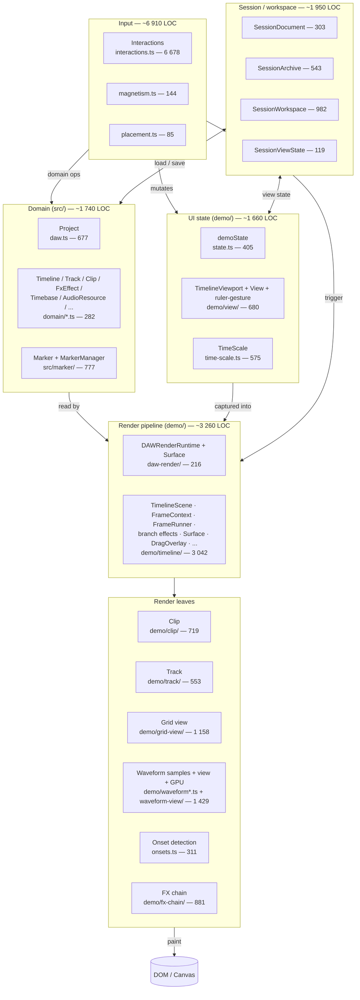
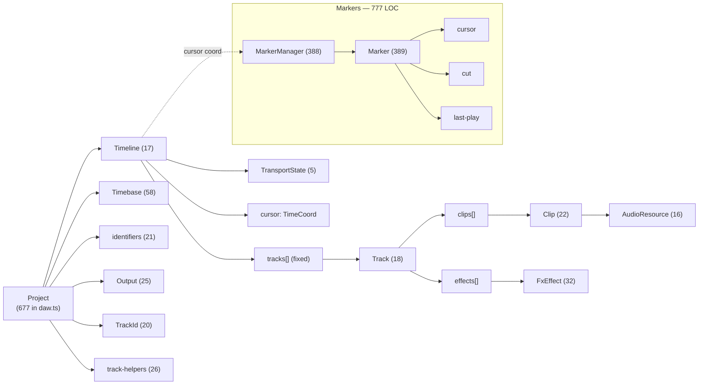
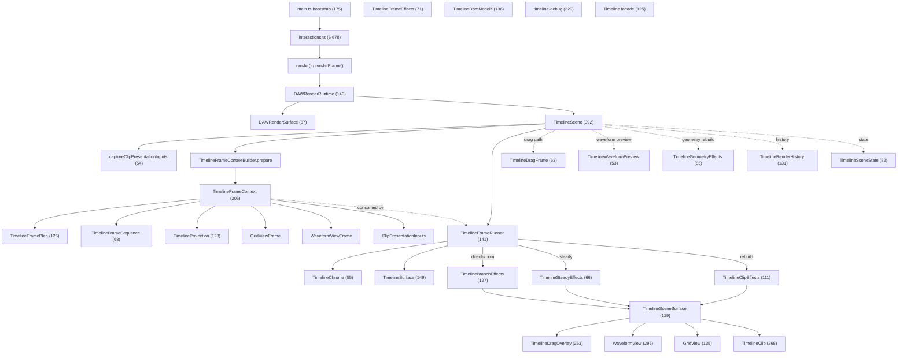
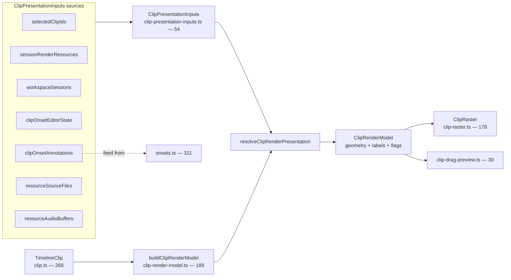
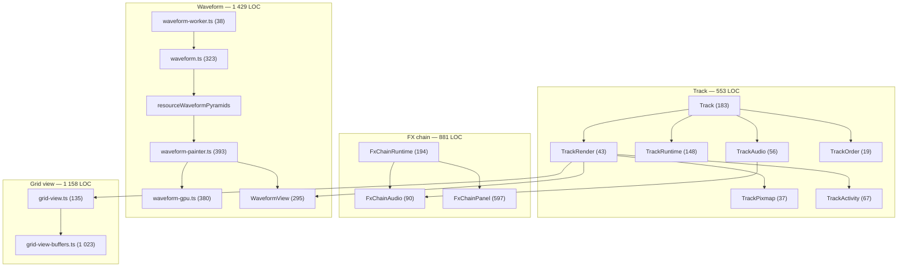
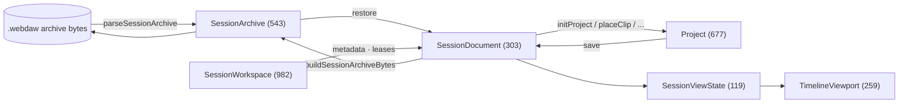
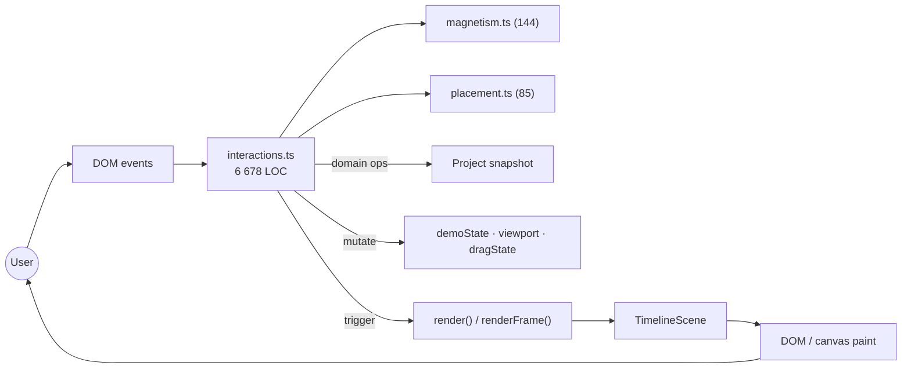

# Concept Graph

High-level view of the main concepts in webdaw and how they relate. Each concept is annotated with its line count (`~N LOC`) so the relative weight of each subsystem is visible at a glance.

## LOC summary (by concept group)

| Group                         |         LOC |
| ----------------------------- | ----------: |
| Input / interactions          |      ~6 910 |
| Render pipeline (timeline)    |      ~3 260 |
| Session / workspace           |      ~1 950 |
| Domain (project + markers)    |      ~1 740 |
| UI state + viewport + scale   |      ~1 660 |
| Waveform (samples + view)     |      ~1 430 |
| Misc bootstrap / utils        |      ~1 280 |
| Grid view (buffers + lines)   |      ~1 160 |
| FX chain                      |        ~880 |
| Clip rendering                |        ~720 |
| Track rendering               |        ~550 |
| Onset detection               |        ~310 |
| **Total (src/ + demo/)**      | **~21 850** |

## 1. Layered overview

## 2. Domain model (~1 740 LOC)

## 3. Render pipeline — main hot path (~3 260 LOC)

## 4. Clip rendering — leaf (~720 LOC)

## 5. Track / FX / Audio / Waveform runtime

## 6. Session lifecycle (~1 950 LOC)

## 7. Input → state → render loop (~6 910 LOC)

---

## Observations

- **`interactions.ts` dwarfs everything** at ~6 680 LOC — nearly a third of the codebase. It's the primary splitting candidate if the demo UI module is ever decomposed.
- The **render pipeline + render leaves** (timeline + clip + track + grid + waveform + daw-render) add up to ~8 560 LOC — the second-largest region.
- **Domain (`src/`) stays small** at ~1 740 LOC despite covering the entire immutable project model. Notably, the marker subsystem alone (`src/marker/`) is ~780 LOC, almost half of the domain.
- **`grid-view-buffers.ts` (1 023 LOC)** is the largest single render-path file — it owns the sliding-buffer mechanism that both the grid and waveform views ride on.
- The new **`clip-presentation-inputs.ts`** is only 54 LOC, but it factors the inputs that used to be read straight from `demoState` inside `clip-render-model.ts` (189 LOC).

## Legend

- **Domain (src/)** is the pure, immutable project model. Every render pass reads a `Project` snapshot.
- **UI state (demo/state.ts + viewport)** is the only mutable demo-side state; it is captured into a `DAWRenderView` and `ClipPresentationInputs` at the render boundary.
- **Render pipeline** builds one `TimelineFrameContext` per frame and dispatches a single branch to paint effects — everything downstream works off that immutable context.
- **Session** round-trips a project to/from a portable archive plus view-state metadata.
- **Input** is the only path that mutates state; it then triggers a render.
