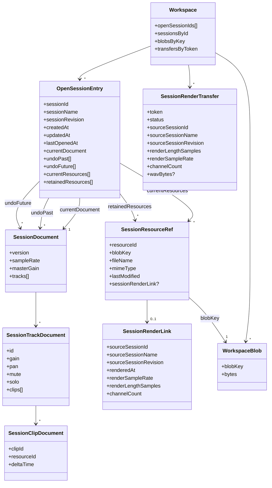
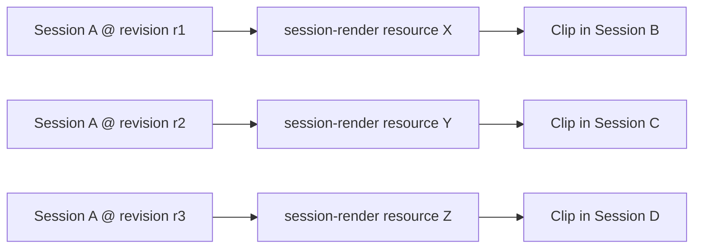
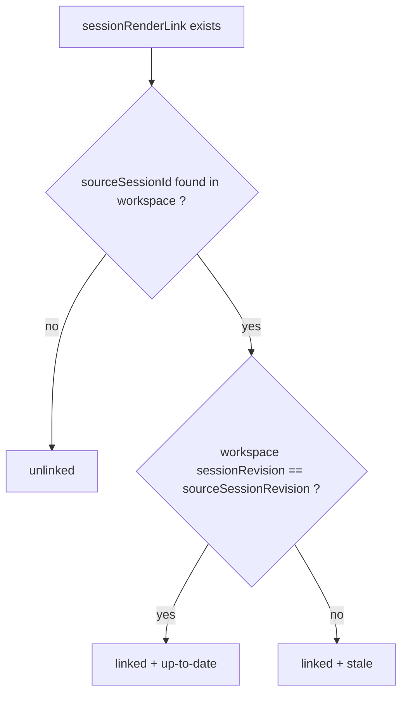
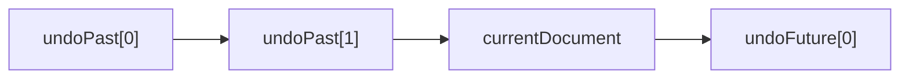
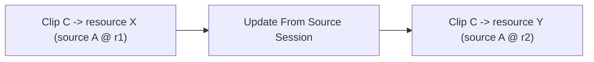
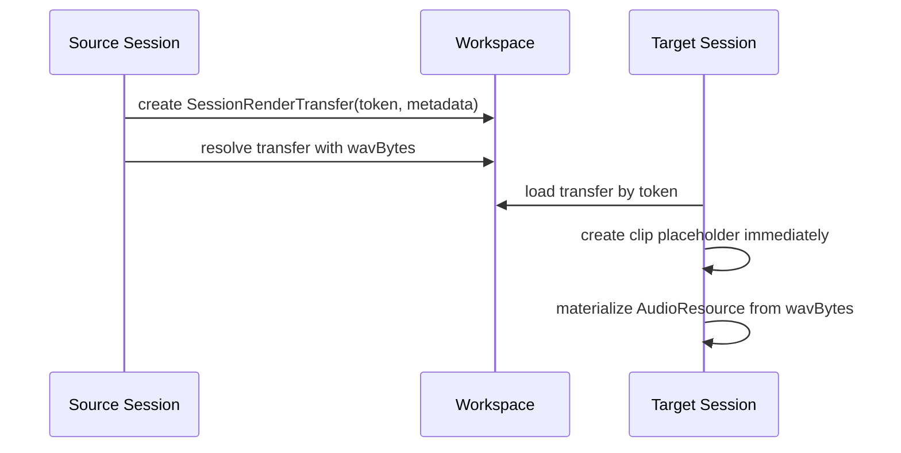

# Modèle de Données

## Objet du document

Ce document propose une vue d'ensemble du **modèle de données** du DAW, au
dessus des spécifications détaillées existantes :

- [SESSIONSPEC.md](/Users/yannorlarey/Documents/Install/webdaw/SESSIONSPEC.md)
- [MULTISESSIONS.md](/Users/yannorlarey/Documents/Install/webdaw/MULTISESSIONS.md)

Le but n'est pas de remplacer ces documents, mais de :

- visualiser les grandes entités ;
- clarifier leurs relations ;
- distinguer les différentes identités techniques ;
- rendre lisible la coexistence de plusieurs rendus issus d'une même session.

## Vue d'ensemble

Le système peut être compris comme l'empilement de quatre couches :

1. les **blobs audio globaux** du workspace
2. les **sessions ouvertes** du workspace
3. le **document courant** et l'**historique undo/redo** de chaque session
4. les **ressources de session-render** dérivées d'autres sessions

Autrement dit :

- le workspace ne stocke pas seulement des sessions ;
- il stocke aussi un graphe de ressources partagées ;
- et certaines de ces ressources représentent des rendus d'autres sessions.

## Schéma principal

## Lecture du schéma

Le schéma principal doit se lire ainsi :

- le **workspace** contient la liste des sessions ouvertes ;
- chaque **session ouverte** possède :
  - un document courant ;
  - un historique undo ;
  - un historique redo ;
  - un ensemble de ressources courantes ;
  - un ensemble plus large de ressources retenues ;
- les **clips** référencent des `resourceId` locaux à la session ;
- chaque ressource locale pointe vers un **blob global** via `blobKey` ;
- certaines ressources locales portent en plus une métadonnée
  `sessionRenderLink`, qui exprime leur origine dans une autre session.

Dans l'implémentation actuelle, la distinction :

- `audio-file`
- `session-render`

est **dérivée** de la présence ou non de `sessionRenderLink`, plutôt que
stockée dans un champ `resourceKind` séparé.

## Identités à ne pas confondre

Le modèle repose sur plusieurs identités distinctes.

### `sessionId`

`sessionId` identifie une **session ouverte** dans le workspace.

Il sert à :

- naviguer vers `?session=<sessionId>`
- retrouver la session source d'un `session-render`
- déterminer si une ressource est `linked` ou `unlinked`

### `sessionName`

`sessionName` est un **label utilisateur**.

Il sert à :

- afficher la session dans le combo
- nommer un export
- enrichir l'UI d'un clip `session-render`

Il ne doit pas être utilisé comme clé technique.

### `sessionRevision`

`sessionRevision` est une **empreinte de contenu** dérivée du
`SessionDocument`.

Elle sert à :

- déterminer si un rendu de session est `up-to-date` ou `stale`
- retrouver exactement le même état après undo/redo

Deux documents strictement identiques doivent donner la même révision.

### `resourceId`

`resourceId` identifie une **ressource audio dans une session donnée**.

Cette identité est locale au point de vue éditorial :

- les clips la référencent ;
- elle peut être remplacée lors d'une opération d'update clip-locale ;
- deux sessions distinctes peuvent très bien avoir des `resourceId`
  différents pour des blobs identiques.

### `blobKey`

`blobKey` identifie le **contenu binaire global** dans le workspace.

Il sert à :

- dédupliquer les fichiers audio stockés localement ;
- partager un même blob entre plusieurs sessions ;
- distinguer l'identité binaire de l'identité éditoriale.

### `sourceSessionRevision`

`sourceSessionRevision` appartient au lien `session-render`.

Il identifie :

- la révision exacte de la session source qui a servi à produire le rendu

Il ne faut pas le confondre avec :

- la révision courante de la session cible ;
- ni même avec la révision actuelle de la session source, qui peut avoir
  évolué depuis.

## Schéma de filiation des `session-render`

Le point clé est qu'une même session source peut engendrer plusieurs ressources
globales différentes, à des moments différents de sa chronologie éditoriale.

Conséquence :

- plusieurs rendus historiques d'une même session peuvent coexister ;
- ils ne doivent pas s'écraser automatiquement ;
- un clip peut rester attaché à un rendu ancien même si la session source a
  continué d'évoluer.

## États dérivés d'une ressource `session-render`

Les états visibles d'une ressource `session-render` sont dérivés, pas
autoritaires.

Il n'est donc pas nécessaire de stocker explicitement :

- `linked`
- `unlinked`
- `up-to-date`
- `stale`

La vérité est :

- la présence de la session source dans le workspace ;
- et la comparaison entre révisions.

## Undo / Redo d'une session ouverte

Une session ouverte doit être comprise comme un document vivant du workspace.

Elle contient :

- un **document courant**
- `undoPast`
- `undoFuture`

Le GC des ressources ne doit donc pas raisonner uniquement sur le document
courant.

Il doit raisonner au minimum sur :

- les ressources du document courant ;
- les ressources retenues par la session ;
- et, si l'on veut un modèle plus strict, les ressources encore atteignables
  via undo/redo.

## Resource retention set

Pour simplifier la gestion de l'undo, une session ouverte peut retenir un
ensemble conservatif de ressources :

- `retainedResources`

Cet ensemble signifie :

- "ces ressources peuvent encore redevenir utiles à cette session"

Cela évite de coupler trop fortement le GC :

- à la structure interne exacte des piles undo/redo ;
- ou à un comptage de références fragile.

## Update d'un clip `session-render`

L'opération `Update From Source Session` doit être comprise comme une
transformation **clip-locale**.

Elle ne modifie pas la ressource historique existante.

Elle doit :

1. rerendre la session source à sa révision courante ;
2. créer une **nouvelle ressource globale** ;
3. créer ou résoudre un nouveau `resourceId` dans la session cible ;
4. remplacer seulement la ressource du clip ciblé ;
5. ajuster sa durée ;
6. repousser les clips suivants si nécessaire ;
7. rester undoable en une seule opération.

Le schéma logique est donc :

`resource X` et `resource Y` doivent pouvoir coexister.

## Drag & drop inter-sessions

Le drag&drop de session entière repose sur un **payload temporaire** :

- `SessionRenderTransfer`

Il ne représente pas encore une ressource stable de la session cible.

Il sert uniquement à transporter :

- l'identité de la session source ;
- sa révision ;
- les dimensions audio attendues ;
- et, quand il est prêt, les bytes du rendu WAV.

Le schéma de séquence conceptuel est :

## Résumé

Le point central du modèle est le suivant :

- une **session** est un document éditorial vivant du workspace ;
- une **ressource** est une entité audio éditoriale locale à une session ;
- un **blob** est un contenu binaire global partagé ;
- un **session-render** est une ressource audio particulière qui dérive d'une
  session source à une révision donnée.

Si cette séparation reste claire, le reste devient beaucoup plus lisible :

- déduplication des blobs ;
- coexistence de plusieurs rendus historiques ;
- états `linked/stale/unlinked` ;
- undo/redo par session ;
- update clip-local sans effet de bord global.
