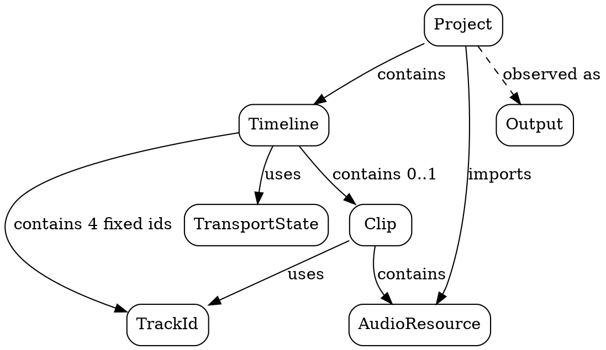

# Spécification du Raffinement Pseudo-Multipiste

## Scénario de référence

Un utilisateur ouvre le WebDAW dans un navigateur. Il crée un projet vide,
importe une ressource audio, puis voit apparaître une timeline contenant quatre
pistes fixes. Un clip unique est placé sur la première piste. L'utilisateur
peut déplacer ce clip horizontalement pour changer son instant de départ, mais
aussi verticalement pour le faire passer d'une piste à une autre. Il lance
ensuite la lecture. Le moteur lit le clip lorsque la tête de lecture traverse
son intervalle temporel, quelle que soit la piste sur laquelle il se trouve.

Ce scénario introduit la dimension verticale de la timeline, sans encore
introduire plusieurs clips simultanés.

## Problème

La V0 spécifie :

- exactement une piste ;
- exactement un clip possible ;
- un déplacement purement horizontal du clip.

Nous voulons raffiner ce modèle pour introduire plusieurs pistes visibles,
tout en gardant une seule entité audio placée à un instant donné sur une piste
donnée.

## Portée de ce raffinement

Cette version introduit :

- exactement quatre pistes fixes ;
- exactement un clip global possible ;
- une position verticale de ce clip via un identifiant de piste ;
- un déplacement du clip à la fois en temps et en piste.

Cette version n'introduit pas encore :

- plusieurs clips ;
- plusieurs clips par piste ;
- lecture simultanée de plusieurs clips ;
- ajout ou suppression dynamique de pistes ;
- mute, solo, gain, panoramique, effets ;
- mixage multipiste réel.

## Vocabulaire du domaine

- **Piste** : ligne temporelle visible dans la timeline.
- **Piste active du clip** : piste sur laquelle le clip unique est actuellement
  placé.
- **Déplacement vertical du clip** : changement de piste du clip sans modifier
  sa ressource audio.

## Types

```math
ProjectId ::= identifiant
TrackId ::= Track1 | Track2 | Track3 | Track4
ResourceId ::= identifiant
SampleRate ::= entier strictement positif
ChannelCount ::= entier strictement positif
FrameCount ::= entier ≥ 0
Time ::= réel ≥ 0

TransportState ::= Stopped | Playing

AudioResource ::= AudioResource(
  id: ResourceId,
  sampleRate: SampleRate,
  channels: ChannelCount,
  length: FrameCount
)

Clip ::= Clip(
  resource: AudioResource,
  start: Time,
  trackId: TrackId
)

Timeline ::= Timeline(
  tracks: Seq<TrackId>,
  clip: Option<Clip>,
  cursor: Time,
  transport: TransportState
)

Output ::= Silence | Signal(resourceId: ResourceId, offset: FrameCount, trackId: TrackId)

Project ::= Project(
  id: ProjectId,
  resources: Set<AudioResource>,
  timeline: Timeline
)
```

Reformulation : le raffinement n'introduit pas encore plusieurs clips. Il
introduit seulement une timeline à quatre pistes et un clip unique dont la
position inclut désormais une composante verticale `trackId`.

## Hiérarchie compositionnelle



Reformulation : la timeline contient maintenant quatre pistes fixes, mais le
clip reste unique. La verticalité est portée par `clip.trackId`, pas par une
collection de clips répartis dans les pistes.

## Invariants

```math
∀ p : Project • p.timeline.cursor ≥ 0
```

```math
∀ p : Project •
  p.timeline.transport ∈ {Stopped, Playing}
```

```math
∀ p : Project •
  p.timeline.tracks = [Track1, Track2, Track3, Track4]
```

```math
∀ p : Project •
  p.timeline.clip = None ∨ p.timeline.clip.start ≥ 0
```

```math
∀ p : Project •
  p.timeline.clip = None ∨ p.timeline.clip.resource ∈ p.resources
```

```math
∀ p : Project •
  p.timeline.clip = None ∨ p.timeline.clip.trackId ∈ p.timeline.tracks
```

Reformulation :

- les quatre pistes existent toujours ;
- le clip est soit absent, soit placé sur exactement une de ces quatre pistes ;
- la tête de lecture et l'instant de départ restent non négatifs ;
- la ressource du clip doit être importée dans le projet.

## État initial

```math
InitProject(id) =
  Project(
    id = id,
    resources = ∅,
    timeline = Timeline(
      tracks = [Track1, Track2, Track3, Track4],
      clip = None,
      cursor = 0,
      transport = Stopped
    )
  )
```

Reformulation : contrairement à une vraie spécification multipiste générale, le
nombre de pistes n'est pas variable. Les quatre pistes sont données d'emblée.

## Opérations

### PlaceClip

```math
resource ∈ p.resources
start ≥ 0
trackId ∈ p.timeline.tracks
────────────────────────────────────────────── [PlaceClip]
PlaceClip⟦p, resource, start, trackId⟧ =
  p{
    timeline ← p.timeline{
      clip ← Clip(resource, start, trackId)
    }
  }
```

### RemoveClip

```math
────────────────────────────────────────────── [RemoveClip]
RemoveClip⟦p⟧ =
  p{
    timeline ← p.timeline{
      clip ← None
    }
  }
```

### MoveClipInTime

```math
p.timeline.clip ≠ None
start ≥ 0
────────────────────────────────────────────── [MoveClipInTime]
MoveClipInTime⟦p, start⟧ =
  p{
    timeline ← p.timeline{
      clip ← p.timeline.clip{
        start ← start
      }
    }
  }
```

### MoveClipToTrack

```math
p.timeline.clip ≠ None
trackId ∈ p.timeline.tracks
────────────────────────────────────────────── [MoveClipToTrack]
MoveClipToTrack⟦p, trackId⟧ =
  p{
    timeline ← p.timeline{
      clip ← p.timeline.clip{
        trackId ← trackId
      }
    }
  }
```

### MoveClip

```math
p.timeline.clip ≠ None
start ≥ 0
trackId ∈ p.timeline.tracks
────────────────────────────────────────────── [MoveClip]
MoveClip⟦p, start, trackId⟧ =
  p{
    timeline ← p.timeline{
      clip ← p.timeline.clip{
        start ← start,
        trackId ← trackId
      }
    }
  }
```

### Seek

```math
time ≥ 0
────────────────────────────────────────────── [Seek]
Seek⟦p, time⟧ =
  p{ timeline ← p.timeline{ cursor ← time } }
```

### Play

```math
────────────────────────────────────────────── [Play]
Play⟦p⟧ =
  p{ timeline ← p.timeline{ transport ← Playing } }
```

### Stop

```math
────────────────────────────────────────────── [Stop]
Stop⟦p⟧ =
  p{ timeline ← p.timeline{ transport ← Stopped } }
```

### Tick

```math
p.timeline.transport = Playing
Δt ≥ 0
────────────────────────────────────────────── [Tick-Playing]
Tick⟦p, Δt⟧ =
  p{ timeline ← p.timeline{ cursor ← p.timeline.cursor + Δt } }
```

```math
p.timeline.transport = Stopped
────────────────────────────────────────────── [Tick-Stopped]
Tick⟦p, Δt⟧ = p
```

Reformulation : la nouveauté essentielle de ce raffinement est que le clip peut
changer de piste aussi simplement qu'il change d'instant de départ.

## Sémantique d'activité

```math
ClipEnd(clip) = clip.start + clip.resource.length / clip.resource.sampleRate
```

```math
ClipActive(p, time) ⇔
  p.timeline.clip ≠ None ∧
  p.timeline.clip.start ≤ time ∧
  time < ClipEnd(p.timeline.clip)
```

Reformulation : la sémantique temporelle du clip ne change pas. Seule sa piste
de rattachement change.

## Sémantique d'observation audio

```math
p.timeline.transport = Stopped
────────────────────────────────────────────── [Observe-Stopped]
Observe⟦p⟧ = Silence
```

```math
p.timeline.transport = Playing
p.timeline.clip = None
────────────────────────────────────────────── [Observe-Empty]
Observe⟦p⟧ = Silence
```

```math
p.timeline.transport = Playing
ClipActive(p, p.timeline.cursor)
offset = (p.timeline.cursor - p.timeline.clip.start) × p.timeline.clip.resource.sampleRate
────────────────────────────────────────────── [Observe-Signal]
Observe⟦p⟧ =
  Signal(
    resourceId = p.timeline.clip.resource.id,
    offset = offset,
    trackId = p.timeline.clip.trackId
  )
```

```math
p.timeline.transport = Playing
¬ ClipActive(p, p.timeline.cursor)
────────────────────────────────────────────── [Observe-Inactive]
Observe⟦p⟧ = Silence
```

Reformulation : l'observation audio reste mono-clip, mais elle porte maintenant
en plus l'information de piste sur laquelle se trouve le clip.

## Questions laissées ouvertes

Ce raffinement laisse volontairement ouvertes les questions suivantes :

- faut-il rendre les quatre pistes nommables ;
- faut-il introduire une couleur ou un état propre à chaque piste ;
- faut-il faire de la piste du clip un vrai composant structurel autonome ;
- faut-il distinguer plus tard déplacement horizontal et déplacement vertical
  au niveau des opérations ;
- faut-il faire apparaître la piste dans l'observation audio, ou seulement dans
  l'état du domaine.

## Axe du raffinement suivant

Le raffinement naturel suivant est :

- passer de `un clip global placé sur une piste` à `au plus un clip par piste` ;
- puis de `au plus un clip par piste` à `plusieurs clips par piste`.
