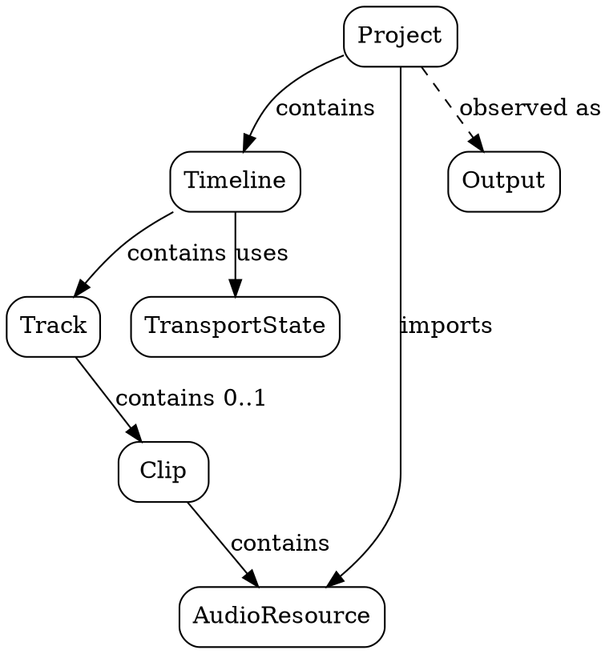

# Spécification du WebDAW

## Scénario de référence

Un utilisateur ouvre le WebDAW dans un navigateur. Il crée un projet vide, importe un
fichier audio et obtient un clip placé sur une piste unique. Il déplace ensuite ce clip
sur la timeline pour choisir son instant de départ, puis lance la lecture. Le moteur lit
le contenu audio du clip lorsque la tête de lecture atteint son intervalle temporel, et
reste silencieux en dehors de cet intervalle. L'utilisateur peut arrêter la lecture,
repositionner le clip, puis relancer une nouvelle lecture.

Ce scénario décrit volontairement le DAW le plus simple possible : un projet, une piste,
un clip, aucune automation, aucun effet, aucun enregistrement, aucun mixage.

## Portée de ce raffinement

Cette version spécifie le noyau minimal du domaine.

- Un projet contient exactement une timeline.
- La timeline contient exactement une piste audio.
- La piste contient au plus un clip.
- Un clip référence une ressource audio complète.
- La lecture produit soit le signal du clip, soit le silence.

Tout ce qui suit est hors portée à ce stade : pistes multiples, clips multiples,
superposition, découpe, boucle, gain, panoramique, effets, MIDI, tempo variable,
édition destructive, collaboration, persistance distante.

## Vocabulaire du domaine

- **Projet** : unité racine manipulée par l'utilisateur.
- **Timeline** : axe temporel du projet.
- **Piste** : conteneur ordonné de matériau audio sur la timeline.
- **Clip** : placement temporel d'une ressource audio sur une piste.
- **Ressource audio** : contenu audio immutable importé dans le projet.
- **Tête de lecture** : position temporelle courante de la lecture.
- **Transport** : état global `Stopped` ou `Playing`.
- **Silence** : sortie audio nulle.

## Types

```text
ProjectId ::= identifiant
ResourceId ::= identifiant
SampleRate ::= entier strictement positif
ChannelCount ::= entier strictement positif
FrameCount ::= entier ≥ 0
Time ::= réel ≥ 0

TransportState ::= Stopped | Playing

AudioResource ::= AudioResource(
  id: ResourceId,
  sampleRate: SampleRate,
  channels: ChannelCount,
  length: FrameCount
)

Clip ::= Clip(
  resource: AudioResource,
  start: Time
)

Track ::= Track(
  clip: Option<Clip>
)

Timeline ::= Timeline(
  track: Track,
  cursor: Time,
  transport: TransportState
)

Project ::= Project(
  id: ProjectId,
  resources: Set<AudioResource>,
  timeline: Timeline
)

Output ::= Silence | Signal(resourceId: ResourceId, offset: FrameCount)
```

Reformulation : le système manipule un projet unique dont l'état observable est défini
par un ensemble de ressources audio et une timeline contenant une seule piste
éventuellement porteuse d'un clip.

## Hiérarchie compositionnelle



Reformulation : la hiérarchie du domaine est strictement descendante. `Project`
compose `Timeline` et l'ensemble des `AudioResource`, `Timeline` compose `Track`,
`Track` compose éventuellement `Clip`, et `Clip` compose directement
`AudioResource`. Les composants ne dépendent pas de leurs agrégats.

## Graduation temporelle de la timeline

La timeline visible est munie de graduations **primaires** et **secondaires**.
Le choix de ces graduations ne dépend pas d'une suite numérique arbitraire ;
il dépend d'une hiérarchie fixe d'unités temporelles.

```math
PrimaryUnit ::= Hour | Minute | Second | Tenth | Millisecond

Next(Hour) = Minute
Next(Minute) = Second
Next(Second) = Tenth
Next(Tenth) = Millisecond
Next(Millisecond) = None

Duration(Hour) = 3600
Duration(Minute) = 60
Duration(Second) = 1
Duration(Tenth) = 0.1
Duration(Millisecond) = 0.001
```

Reformulation : les seules unités primaires admissibles sont l'heure, la minute,
la seconde, le dixième de seconde et la milliseconde. L'unité secondaire associée
à une unité primaire est toujours l'unité immédiatement plus fine.

### Échelle de zoom

Le zoom de la timeline n'est pas continu. Il est défini par une échelle discrète
ordonnée de niveaux de zoom, dérivée systématiquement des rapports de subdivision
entre unités successives.

```math
SubdivisionCount(Hour, Minute) = 60
SubdivisionCount(Minute, Second) = 60
SubdivisionCount(Second, Tenth) = 10
SubdivisionCount(Tenth, Millisecond) = 100
```

```math
Divisors(n) = { d ∈ N | d ≥ 1 ∧ d divise n }
```

```math
AllowedGroupings(u) =
  Divisors(SubdivisionCount(u, Next(u))) si Next(u) ≠ None
  {1} sinon
```

```math
ZoomLevel ::= ZoomLevel(
  primaryUnit: PrimaryUnit,
  secondaryUnit: Option<PrimaryUnit>,
  secondaryGrouping: entier strictement positif
)
```

```math
WellFormed(z) ⇔
  secondaryUnit(z) = Next(primaryUnit(z)) ∧
  secondaryGrouping(z) ∈ AllowedGroupings(primaryUnit(z))
```

```math
PrimaryStep(z) =
  secondaryGrouping(z) × Duration(secondaryUnit(z)) si secondaryUnit(z) ≠ None
  Duration(primaryUnit(z)) sinon
```

Reformulation : un niveau de zoom ne choisit pas seulement une unité primaire
et une unité secondaire ; il choisit aussi combien d'unités secondaires sont
regroupées pour former une graduation primaire. Les regroupements admissibles
ne sont pas choisis à la main : ce sont exactement les diviseurs entiers du
nombre de subdivisions entre l'unité primaire et l'unité secondaire.

### Ordre de l'échelle

L'échelle est totalement ordonnée du plus grossier au plus fin. Pour une unité
primaire donnée, on parcourt ses regroupements autorisés du plus grand au plus
petit, puis on passe à l'unité primaire suivante plus fine. Pour la V0, l'ordre
normatif est :

```math
ZoomScale =
[
  (Hour, Minute, d) pour d ∈ Divisors(60) parcourus du plus grand au plus petit,
  (Minute, Second, d) pour d ∈ Divisors(60) parcourus du plus grand au plus petit,
  (Second, Tenth, d) pour d ∈ Divisors(10) parcourus du plus grand au plus petit,
  (Tenth, Millisecond, d) pour d ∈ Divisors(100) parcourus du plus grand au plus petit,
  (Millisecond, None, 1)
]
```

Reformulation : zoomer ou dézoomer revient à se déplacer d'un cran dans cette
liste ordonnée, jamais à recalculer librement un pas de temps.

### Paramètres de visibilité

```math
P : entier strictement positif
D : durée strictement positive
digit_space : réel strictement positif
```

Reformulation : `P` est la largeur visible en pixels, `D` la durée visible et
`digit_space` l'espace minimal requis pour afficher lisiblement un chiffre de
label secondaire.

### Critère de lisibilité d'un niveau

```math
PrimarySpacingPx(P, D, z) = P × PrimaryStep(z) / D
```

```math
SecondarySpacingPx(P, D, z) =
  P × Duration(secondaryUnit(z)) / D
  si secondaryUnit(z) ≠ None
  0 sinon
```

```math
SecondaryDigits(z) =
  2 si secondaryUnit(z) = Minute
  2 si secondaryUnit(z) = Second
  1 si secondaryUnit(z) = Tenth
  2 si secondaryUnit(z) = Millisecond
  0 sinon
```

```math
SecondaryNeededSpace(z, digit_space) =
  SecondaryDigits(z) × digit_space + SecondaryMarginPx
```

```math
PrimaryNeededSpace(z, digit_space) =
  PrimaryDigits(z) × PrimaryDigitFactor × digit_space + PrimaryMarginPx
```

```math
Readable(P, D, digit_space, z) ⇔
  PrimarySpacingPx(P, D, z) ≥ PrimaryNeededSpace(z, digit_space) ∧
  (
    secondaryUnit(z) = None ∨
    SecondarySpacingPx(P, D, z) ≥ SecondaryNeededSpace(z, digit_space)
  )
```

```math
ChooseScale(P, D, digit_space) =
  le niveau z le plus fin de ZoomScale tel que Readable(P, D, digit_space, z)
```

Reformulation : pour une largeur `P`, une durée visible `D` et un espace
minimal `digit_space`, on choisit le niveau le plus fin dont les graduations
primaires et secondaires restent lisibles. Les labels secondaires ont une
police plus petite, mais leur espacement doit rester compatible avec le nombre
de chiffres à afficher.

### Sémantique de rendu

```math
PrimaryMarks(z) = { t = k × PrimaryStep(z) | k ∈ Z }

SecondaryMarks(z) =
  { t = k × Duration(secondaryUnit(z)) | k ∈ Z }
  si secondaryUnit(z) ≠ None
  sinon ∅
```

```math
RenderedPrimaryMarks =
  { t ∈ PrimaryMarks(z) |
    VisibleStart ≤ t ≤ VisibleStart + VisibleDuration }

RenderedSecondaryMarks =
  { t ∈ SecondaryMarks(z) |
    VisibleStart ≤ t ≤ VisibleStart + VisibleDuration ∧
    t ∉ RenderedPrimaryMarks }
```

```math
PrimaryLabels(z) =
  valeurs absolues associées aux graduations primaires visibles
```

```math
SecondaryLabels(z) =
  valeurs relatives associées aux graduations secondaires visibles
```

Reformulation :

- les graduations primaires sont espacées par `PrimaryStep(z)` ;
- les graduations secondaires sont portées par l'unité immédiatement plus fine
  du niveau `z` ;
- une graduation secondaire qui coïncide avec une graduation primaire n'est pas
  redessinée comme secondaire ;
- les labels primaires sont affichés dans une police plus grande ;
- les labels secondaires sont affichés dans une police plus petite ;
- un niveau n'est pas retenu si l'espacement entre graduations ne permet pas
  d'afficher lisiblement les labels associés ;
- les positions des graduations sont attachées à leurs dates absolues et se
  déplacent avec le défilement de la fenêtre visible.

### Contraintes de zoom et de viewport

```math
ZoomAnchorX ∈ [0, ViewportWidthPx]
ZoomAnchorTime = VisibleStart + (ZoomAnchorX / ViewportWidthPx) × VisibleDuration
```

```math
Après un changement d'échelle:
  ZoomAnchorTime reste associé à la même abscisse ZoomAnchorX
```

```math
VisibleStart ≥ -VisibleDuration
```

```math
ZoomIn(z) = niveau suivant plus fin dans l'échelle
ZoomOut(z) = niveau suivant plus grossier dans l'échelle
```

Reformulation :

- un zoom est ancré sur une abscisse de la règle temporelle ;
- l'instant situé sous cette abscisse avant zoom reste sous cette même abscisse
  après zoom ;
- zoomer ou dézoomer consiste à changer de niveau dans l'échelle discrète ;
- la fenêtre visible peut montrer du temps négatif, mais pas au point de perdre
  entièrement l'instant `0`.

## Fonctions dérivées

```math
End⟦p, c⟧ : Project × Clip → Time
End⟦p, c⟧ := c.start + (c.resource.length / c.resource.sampleRate)

Active⟦p, t⟧ : Project × Time → Bool
Active⟦p, t⟧ := ∃ c = p.timeline.track.clip : c ≠ None ∧ c.start ≤ t ∧ t < End⟦p, c⟧
```

Reformulation : un clip est actif à l'instant `t` si cet instant appartient à l'intervalle
temporel couvert par sa ressource placée sur la timeline.

## Invariants

```math
I1. ∀ p : Project, p.timeline.cursor ≥ 0

I2. ∀ p : Project, ∀ c ∈ {x | x = p.timeline.track.clip ∧ x ≠ None}, c.start ≥ 0

I3. ∀ p : Project, ∀ c ∈ {x | x = p.timeline.track.clip ∧ x ≠ None},
    c.resource ∈ p.resources

I4. ∀ p : Project, ∀ r1, r2 ∈ p.resources, r1.id = r2.id ⇒ r1 = r2

I5. ∀ p : Project, p.timeline.transport = Stopped ∨ p.timeline.transport = Playing
```

Reformulation :

- le curseur ne devient jamais négatif ;
- le début d'un clip ne devient jamais négatif ;
- un clip ne peut contenir qu'une ressource importée dans le projet ;
- deux ressources distinctes ne partagent pas le même identifiant ;
- le transport reste dans un ensemble fini d'états valides.

## État initial

```math
Init⟦pid⟧ = Project(
  id = pid,
  resources = ∅,
  timeline = Timeline(
    track = Track(clip = None),
    cursor = 0,
    transport = Stopped
  )
)
```

Reformulation : un projet nouvellement créé est vide, immobile et silencieux.

## Opérations

### Import d'une ressource audio

```math
Import⟦p, r⟧ : Project × AudioResource → Project

Pré:
- ¬∃ e ∈ p.resources, e.id = r.id

Post:
- Import⟦p, r⟧.resources = p.resources ∪ {r}
- Import⟦p, r⟧.timeline = p.timeline
- Import⟦p, r⟧ satisfait I1..I5
```

Reformulation : importer ajoute une nouvelle ressource, sans modifier la timeline.

### Placement du clip unique

```math
PlaceClip⟦p, r, start⟧ : Project × AudioResource × Time → Project

Pré:
- start ≥ 0
- r ∈ p.resources

Post:
- PlaceClip⟦p, r, start⟧.timeline.track.clip = Clip(resource = r, start = start)
- PlaceClip⟦p, r, start⟧.resources = p.resources
- PlaceClip⟦p, r, start⟧.timeline.cursor = p.timeline.cursor
- PlaceClip⟦p, r, start⟧.timeline.transport = p.timeline.transport
- PlaceClip⟦p, r, start⟧ satisfait I1..I5
```

Reformulation : la piste ne contient qu'un seul clip ; le placement remplace donc
éventuellement le clip précédent.

### Suppression du clip

```math
RemoveClip⟦p⟧ : Project → Project

Post:
- RemoveClip⟦p⟧.timeline.track.clip = None
- RemoveClip⟦p⟧.resources = p.resources
- RemoveClip⟦p⟧.timeline.cursor = p.timeline.cursor
- RemoveClip⟦p⟧.timeline.transport = p.timeline.transport
- RemoveClip⟦p⟧ satisfait I1..I5
```

Reformulation : supprimer le clip vide la piste sans affecter les ressources importées.

### Déplacement du curseur

```math
Seek⟦p, t⟧ : Project × Time → Project

Pré:
- t ≥ 0

Post:
- Seek⟦p, t⟧.timeline.cursor = t
- Seek⟦p, t⟧.timeline.track = p.timeline.track
- Seek⟦p, t⟧.timeline.transport = p.timeline.transport
- Seek⟦p, t⟧.resources = p.resources
- Seek⟦p, t⟧ satisfait I1..I5
```

Reformulation : le déplacement du curseur change uniquement la position temporelle.

### Lancement et arrêt du transport

Play⟦p⟧ : Project → Project
Stop⟦p⟧ : Project → Project

Post Play:
- Play⟦p⟧.timeline.transport = Playing
- Play⟦p⟧ conserve toutes les autres composantes de p

Post Stop:
- Stop⟦p⟧.timeline.transport = Stopped
- Stop⟦p⟧ conserve toutes les autres composantes de p


Reformulation : le transport contrôle uniquement l'état de lecture, pas le contenu du
projet.

## Sémantique d'observation audio

```math
O⟦p⟧ : Project → Output

p.timeline.transport = Stopped
──────────────────────────────────────── [Obs-Stopped]
O⟦p⟧ = Silence

p.timeline.transport = Playing
p.timeline.track.clip = None
──────────────────────────────────────── [Obs-Playing-Empty]
O⟦p⟧ = Silence

p.timeline.transport = Playing
p.timeline.track.clip = c
¬Active⟦p, p.timeline.cursor⟧
──────────────────────────────────────── [Obs-Playing-Out]
O⟦p⟧ = Silence

p.timeline.transport = Playing
p.timeline.track.clip = c
Active⟦p, p.timeline.cursor⟧
offset = floor((p.timeline.cursor - c.start) × c.resource.sampleRate)
──────────────────────────────────────── [Obs-Playing-In]
O⟦p⟧ = Signal(resourceId = c.resource.id, offset = offset)
```

Reformulation : en lecture, la sortie est le signal de la ressource au décalage
correspondant si le curseur se trouve dans l'intervalle du clip ; sinon la sortie est
le silence.

## Règle d'évolution temporelle minimale

```math
Tick⟦p, Δt⟧ : Project × Time → Project

Pré:
- Δt ≥ 0

p.timeline.transport = Stopped
──────────────────────────────────────── [Tick-Stopped]
Tick⟦p, Δt⟧ = p

p.timeline.transport = Playing
──────────────────────────────────────── [Tick-Playing]
Tick⟦p, Δt⟧ = p{timeline.cursor ← p.timeline.cursor + Δt}
```

Reformulation : seul l'état `Playing` fait progresser la tête de lecture.

## Propriétés attendues

```math
P1. ∀ p, O⟦Stop⟦p⟧⟧ = Silence

P2. ∀ p, t ≥ 0, Seek⟦p, t⟧ satisfait I1..I5

P3. ∀ p, r, start, si PlaceClip⟦p, r, start⟧ est définie,
    alors Active⟦PlaceClip⟦p, r, start⟧, t⟧ ⇒ start ≤ t

P4. ∀ p, Δt ≥ 0, p.timeline.transport = Stopped ⇒ Tick⟦p, Δt⟧ = p
```

Reformulation : l'arrêt impose le silence, les opérations préservent les invariants, et
la progression temporelle ne survient que pendant la lecture.

## Axe de raffinement

Les raffinements suivants devront préserver la validité des concepts et propriétés
ci-dessus tout en enrichissant le modèle. L'ordre naturel est le suivant :

1. généraliser `Track.clip` en séquence de clips non chevauchants ;
2. généraliser la timeline à plusieurs pistes ;
3. introduire gain, mute et mixage ;
4. introduire découpe, boucle et édition de clips ;
5. introduire tempo, grille et événements MIDI ;
6. introduire effets, automation et rendu hors ligne.

Chaque raffinement devra expliciter :

- les nouveaux types ;
- les nouveaux invariants ;
- les opérations ajoutées ou modifiées ;
- les propriétés conservées et les propriétés nouvelles.
